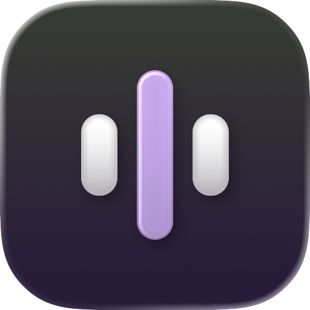
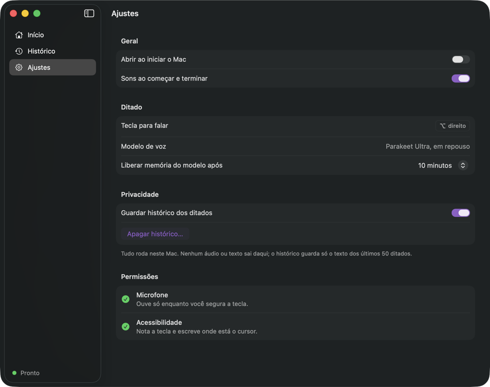
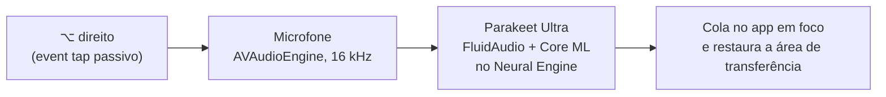

<div align="center">



# Tagara

**Segura uma tecla, fala, solta. O texto aparece onde está o cursor.**

Ditado por voz para macOS que roda inteiro no seu Mac: sem nuvem, sem conta, sem assinatura.

[](https://github.com/mateusfonsek/tagara/releases/latest)
[](https://github.com/mateusfonsek/tagara/actions/workflows/release.yml)
[](#requisitos)
[](#requisitos)
[](LICENSE)

[Baixar](https://github.com/mateusfonsek/tagara/releases/latest) · [Como funciona](#como-funciona) · [Compilar](#compilar-do-código) · [Contribuir](#contribuindo)

</div>

---

## Por que o Tagara

Digitar é lento. Falar é três vezes mais rápido. O Tagara transforma o **⌥ direito** do seu teclado num botão de falar: você segura, fala, solta, e o texto é escrito no app que estiver em foco. Funciona no terminal (inclusive no Claude Code), no Slack, no WhatsApp, no navegador e em qualquer campo de texto.

A diferença para os apps de ditado mais conhecidos é que **nada sai do seu Mac**. A transcrição roda no Neural Engine do Apple Silicon, com um modelo aberto, e o app fica parado em segundo plano sem gastar CPU.

## Destaques

- **100% local e offline.** O áudio nunca é gravado em disco nem enviado para lugar nenhum. Depois de baixar o modelo uma vez, funciona sem internet.
- **Rápido.** Parakeet Ultra no Neural Engine: uma frase vira texto em cerca de 0,2 a 0,4 s depois que você solta a tecla.
- **Português e inglês.** O modelo reconhece o idioma a cada ditado, então dá para alternar frases em PT e EN.
- **Leve.** Parado, usa 0% de CPU e o microfone fica fechado. O modelo sai da memória sozinho depois de alguns minutos sem uso e volta enquanto você fala.
- **Em qualquer app.** Escreve onde está o cursor e devolve a sua área de transferência como estava.
- **Histórico local.** Os últimos 50 ditados ficam numa aba própria, com busca, para copiar de novo o que se perdeu. Dá para desligar.
- **Nativo.** SwiftUI, barra de menu, ícone Liquid Glass do macOS 26 e modo claro e escuro do sistema.

<div align="center">
  
</div>

## Instalação

1. Baixe o `Tagara-x.y.z.dmg` da [última release](https://github.com/mateusfonsek/tagara/releases/latest).
2. Abra o DMG e arraste o **Tagara** para **Aplicativos**.
3. **Primeira abertura.** O Tagara ainda não é assinado com um certificado de desenvolvedor da Apple, então o macOS vai bloquear a primeira abertura. Para liberar, escolha um dos caminhos:
   - Em **Ajustes do Sistema → Privacidade e Segurança**, clique em **Abrir mesmo assim**; ou
   - no Terminal: `xattr -dr com.apple.quarantine /Applications/Tagara.app`
4. Na janela do Tagara, permita o **Microfone** e a **Acessibilidade** e baixe o **modelo de voz** (cerca de 630 MB, uma vez só).

Pronto: segure **⌥ direito**, fale e solte.

> [!NOTE]
> Cada atualização instalada pelo DMG é uma nova assinatura para o macOS, então ele pode pedir as permissões de novo. Compilando localmente com `scripts/setup-signing.sh`, as permissões ficam guardadas entre builds.

## Requisitos

| | |
|---|---|
| Sistema | macOS 15 ou mais novo (desenvolvido e testado no macOS 26) |
| Processador | Apple Silicon (M1 em diante); o modelo roda no Neural Engine |
| Espaço | cerca de 650 MB, quase tudo do modelo de voz |
| Permissões | Microfone (para ouvir enquanto a tecla está apertada) e Acessibilidade (para notar a tecla e escrever no app em foco) |

## Como usar

| Ação | Como |
|---|---|
| Ditar | Segure **⌥ direito**, fale e solte |
| Cancelar | Aperte qualquer outra tecla enquanto segura o ⌥ (atalhos com ⌥ continuam funcionando) |
| Recuperar um texto | Menu do Tagara na barra de menu → **Copiar último ditado**, ou a aba **Histórico** |
| Ajustes | Abrir ao iniciar o Mac, sons, histórico e quanto tempo o modelo fica na memória |

Enquanto você fala, uma pílula discreta aparece embaixo, no centro da tela, com três barras que acompanham a sua voz.

## Como funciona



1. **Tecla.** Um *event tap* só de leitura nota quando o ⌥ direito é apertado sozinho. Se outra tecla entra junto, é um atalho e o ditado é cancelado.
2. **Áudio.** O microfone abre só enquanto a tecla está apertada; o áudio fica na memória, em 16 kHz mono.
3. **Transcrição.** O [Parakeet Ultra](https://huggingface.co/moondream/parakeet-ultra) (pós-treino do Parakeet TDT v3 da NVIDIA, 25 idiomas) roda via [FluidAudio](https://github.com/FluidInference/FluidAudio) no Neural Engine. O modelo carrega em paralelo enquanto você fala e é liberado após um tempo sem uso.
4. **Escrita.** O texto é colado com ⌘V no app em foco e a área de transferência anterior é restaurada logo depois. Gerenciadores de área de transferência são avisados para ignorar essa entrada.

## Privacidade

- O áudio nunca é salvo em disco e nunca sai do Mac.
- O histórico guarda **só o texto** dos últimos 50 ditados, em `~/Library/Application Support/Tagara/history.json`, legível apenas pelo seu usuário. Dá para apagar ou desligar nos Ajustes.
- O app não tem telemetria, conta nem servidor. A única conexão é o download do modelo de voz, uma vez, do Hugging Face.

## Compilar do código

Precisa do **Xcode 26** (o ícone Liquid Glass é compilado pelo `actool` do Xcode 26).

```bash
git clone https://github.com/mateusfonsek/tagara.git
cd tagara

swift test                    # testes da lógica
scripts/setup-signing.sh      # opcional: certificado local para as permissões não resetarem
scripts/install.sh            # compila e instala em ~/Applications/Tagara.app
VERSION=0.1.0 scripts/dmg.sh  # gera dist/Tagara-0.1.0.dmg
```

### Estrutura

```
Sources/Tagara/       app: barra de menu, janela, pílula, tecla, áudio, transcrição e escrita
Sources/TagaraCore/   lógica pura e testada: tecla, estatísticas, histórico, barras
Tests/                testes (Swift Testing)
Resources/            Info.plist, ícone (.icon do Icon Composer) e cor de destaque
scripts/              bundle, install, dmg e certificado local
docs/                 brand guidelines
```

### Releases automáticas

Cada push na `main` roda os testes num runner `macos-26`, gera o DMG e publica uma release `v<VERSION>.<número do build>` com as notas geradas a partir dos commits. Pull requests rodam os testes e o build, sem publicar. Veja [`.github/workflows/release.yml`](.github/workflows/release.yml).

## Roadmap

- Vocabulário próprio (nomes e termos técnicos como `kubectl`) com o *vocabulary boosting* do FluidAudio
- Tecla de ditado configurável
- Assinatura e notarização com Developer ID, para abrir sem aviso do macOS

## Contribuindo

Issues e pull requests são bem-vindos. Para mudanças grandes, abra uma issue antes para conversarmos sobre a ideia.

1. Faça um fork e crie uma branch a partir da `main`.
2. Rode `swift test` e teste o app com `scripts/install.sh`.
3. Abra o pull request descrevendo o que mudou e por quê.

A identidade visual (cores, voz e ícone) está em [`docs/brand-guidelines.md`](docs/brand-guidelines.md).

## Créditos e licenças

- Código do Tagara: [MIT](LICENSE).
- [FluidAudio](https://github.com/FluidInference/FluidAudio), da FluidInference: Apache 2.0.
- [Parakeet TDT 0.6B v3](https://huggingface.co/nvidia/parakeet-tdt-0.6b-v3), da NVIDIA, e o pós-treino [Parakeet Ultra](https://huggingface.co/moondream/parakeet-ultra), da Moondream: CC BY 4.0. O modelo é baixado pelo app e não é redistribuído aqui.
- [Atkinson Hyperlegible Next](https://github.com/googlefonts/atkinson-hyperlegible-next), do Braille Institute, usada na marca: SIL Open Font License (`branding/fonts/OFL.txt`).

<div align="center">
  <sub>Feito no Brasil, para quem fala muito. 🇧🇷</sub>
</div>
